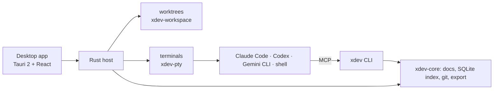

# xDev

Local-first agentic IDE. **[xdev.asia](https://xdev.asia)**

Run Claude Code, Codex, Gemini CLI and other coding agents side by side, each in its own git worktree and its own terminal. Review every diff before it lands. Your docs and project context reach the agents over files and MCP, so they read less and guess less.

> Status: early preview (0.5). Builds are unsigned; expect breaking changes.

## What you get

- **Worktrees and tabs.** One worktree per task, with setup scripts, panes and tabs you can split and restore.
- **Agents in real terminals.** The agent CLIs you already use, with live status, notifications and per-account usage.
- **Review and git.** Per-file diffs, review notes, commit, pull requests.
- **Context.** Markdown docs indexed locally (full text and vectors), stale-doc checks, `AGENTS.md` / `CLAUDE.md` export and an MCP server.

## Architecture

Full map: [xdev/docs/architecture.md](https://github.com/xdev-asia/xdev/blob/main/docs/architecture.md). Decisions: [xdev/docs/adr](https://github.com/xdev-asia/xdev/tree/main/docs/adr).

## Repositories

| Repo | What | Status |
|---|---|---|
| [xdev](https://github.com/xdev-asia/xdev) | The IDE: Rust crates, `xdev` CLI, desktop app (Tauri 2), architecture decisions | Active |
| [site](https://github.com/xdev-asia/site) | Website at [xdev.asia](https://xdev.asia) (Next.js, static export) | Active |
| [registry](https://github.com/xdev-asia/registry) | Signed index of app packs the desktop app can install, plus a block list | Placeholder |

## Get it

Installers for Windows (x64, ARM64), macOS (Apple silicon) and Linux (x64, ARM64) are on the [xdev releases page](https://github.com/xdev-asia/xdev/releases). The app updates itself when a new version ships.

## Principles

- Local first: your code, docs and sessions stay on your machine.
- Bring your own agents and accounts; xDev does not resell models.
- Agents work in worktrees; nothing reaches your branch without your review.
- Policy is checked by the app, not by a prompt.

## License

Open source under Apache-2.0.
